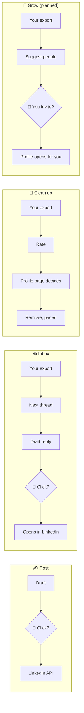
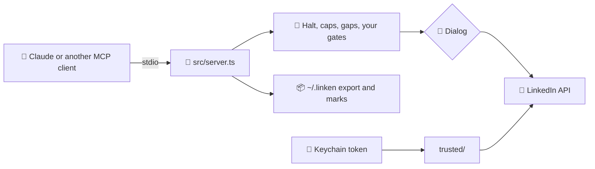

# Linken spec

🎯 Your LinkedIn, run by Claude. Nothing posts until you click.

This page says what Linken is, what it does, and what it will not do. The [README](README.md) shows how to start. [How it decides](docs/decide.md) shows the clean-up rules.

## 1 · Who it is for

| Person | Wants |
| --- | --- |
| 👤 A LinkedIn member | Posts and replies in their own voice, with less time spent |
| 🧹 A member with a messy network | Fewer spam connections, with nobody who matters removed |
| 👥 A member who wants to grow | A short list of people worth knowing, drawn from their own data |
| 🛠️ A builder | A small, readable MCP server to learn from or extend |

## 2 · The jobs

| Job | Tools | Reads | Writes |
| --- | --- | --- | --- |
| ✍️ Post | `post_publish`, `comment_create` | Your draft | A post or comment, after your click |
| 📥 Inbox | `inbox_next`, `inbox_mark`, `reply_open` | Your data export | A local mark; the reply opens for you to send |
| 🧹 Clean up | `connections_summary`, `connections_list`, `connections_next`, `connections_check`, `connections_check_list`, `connections_mark` | Your data export, the live profile page | A local mark; you remove in LinkedIn, paced |
| 👥 Grow (planned) | `people_suggest`, `people_mark` | Your data export only | A local mark; the profile opens and you send the invite |
| ⚙️ Setup | `archive_load`, `linken_status` | `~/.linken` | Nothing on LinkedIn |

## 3 · Rules that never bend

| # | Rule | Enforced by |
| --- | --- | --- |
| 1 | 👤 Every post and comment waits for your click in the approval dialog | `trusted/linken-linkedin` dialog |
| 2 | 🛑 The halt file `~/.linken/halt` stops every action | `src/core.ts` |
| 3 | ⏱️ Daily and sitting caps, with random 15 to 45 second gaps. A cap can go down, never up | `src/connections.ts`, [clean-up guide](docs/connections.md) |
| 4 | 🔎 The live profile page decides a removal. The export only suggests | `src/levels.ts` |
| 5 | 🏠 The token stays in the Keychain. Data stays in `~/.linken`. Nothing leaves your machine but the API call you approved | `trusted/`, `install.sh` |
| 6 | 🧪 A dev session never calls LinkedIn live: it uses `LINKEN_DRY_RUN=1` | `src/core.ts` |
| 7 | 🙈 No member data in this repo: fixtures are fictional | `tests/privacy.test.ts` |

### 👥 Grow, planned (#103)

| Rule | Detail |
| --- | --- |
| 📦 Source | Only your own export: invitations you received, people who wrote to you, people you wrote to but never connected with |
| 🙅 Never | No search of LinkedIn, no stranger lists, no bought data |
| 👤 You act | Linken opens the profile. You send the invite in LinkedIn |
| ⏱️ Pace | Same halt file and daily caps as clean-up |
| 🧭 Fit | Ranked by your `mission` and `places` words in `~/.linken/rater.json` |

## 4 · Out of scope

| Not doing | Why |
| --- | --- |
| 🤖 Posting on a schedule, or without a click | A post is the member's own act |
| 📨 Sending messages or invitations for you | `reply_open` and Grow open LinkedIn for you; you press send |
| 🕷️ Scraping other people's profiles in bulk | Only the one page you open is read, one at a time |
| ☁️ A hosted service | Local only: no server holds anyone's token or data |
| 📈 Growth hacks (engagement pods, auto-likes) | They break LinkedIn's terms and the member's trust |

## 5 · How it is built

| Part | Where |
| --- | --- |
| Runtime | Node 26 runs `src/*.ts`, no build |
| Your gates | `LINKEN_GATES`: your own checks run before any write |
| Word lists | `rules/rater.default.json`, your `~/.linken/rater.json` |
| Skills | `skills/linken-post`, `skills/linken-inbox`, `skills/linken-cleanup` |
| Tests | `tests/`, run in CI |
| Scores | [Quality page](https://colorado-startups.github.io/linken/) |

## 6 · Done means

| Check | Target |
| --- | --- |
| Try it with sample data | Under 2 minutes, no LinkedIn account |
| Install to first approved post | 3 steps in the [README](README.md) |
| Posts without a click | 0 |
| Connections removed that the page showed as mattering | 0 |
| Quality page overall | 100 |

## 7 · Changing this spec

A change to sections 3 or 4 is a vision change. It needs its own pull request and the maintainer's approval in [MAINTAINERS.md](MAINTAINERS.md).
