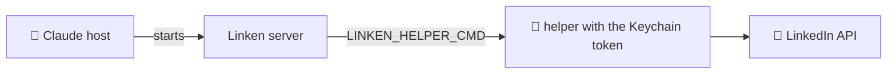

# Add Linken to your Claude host

Step 7 of [Set up Linken](setup.md). Pick one row.



| Host | Do | Gets |
| --- | --- | --- |
| Claude desktop, Chat and Code tab | Settings, Developer, Edit Config: add the block below, then restart Claude | Tools |
| Claude Code or Cowork plugin | `/plugin install linken --marketplace Colorado-Startups/linken` (Claude Code 2.1.275 or later). Its first session installs the two npm dependencies into the plugin's data folder, with install scripts off; if the tools are missing, start one more session | Tools and the 3 skills |
| A project's `.mcp.json` | The block below, in that file | Tools |
| Skills in Chat | Zip a folder from `skills/`, then Customize, Skills, Upload a skill | Skills |

If Claude cannot find `node`, put its absolute path in `command`. Sources: [connect local servers](https://modelcontextprotocol.io/docs/develop/connect-local-servers), [plugins](https://code.claude.com/docs/en/plugins-reference), [skills](https://support.claude.com/en/articles/12512180-use-skills-in-claude), read 2026-11-13.

```json
{
  "mcpServers": {
    "linken": {
      "command": "node",
      "args": ["/absolute/path/to/linken/src/server.ts"],
      "env": {
        "LINKEN_HELPER_CMD": "[\"/bin/sh\",\"-c\",\"LINKEDIN_ACCESS_TOKEN=\\\"$(/usr/bin/security find-generic-password -s linken-linkedin -w)\\\" exec /usr/local/bin/linken-linkedin\"]"
      }
    }
  }
}
```

| Variable | Needed | Meaning |
| --- | --- | --- |
| `LINKEN_HELPER_CMD` | Yes, for live calls | JSON array that starts the helper with the token (above) |
| `LINKEN_HOME` | No | Data folder. Default `~/.linken` |
| `LINKEN_DRY_RUN` | No | `1` calls no helper and writes no ledger line |
| `LINKEN_GATES` | No | Commands that read each write as JSON on stdin and can block it |
| `LINKEN_MCP_SKILLS` | No | `0` stops serving the three skills over MCP. The plugin sets it, since it ships them as plugin skills |

| Optional file | Meaning |
| --- | --- |
| `voice.md` in the data folder | Your voice guide: tone, words to use and words to avoid. `linken_status` returns it as `voice`, and the `linken-post` skill follows it when drafting. It stays on your Mac |

The token goes Keychain → helper, never into the server. A `LINKEDIN_ACCESS_TOKEN` in the server's own environment makes every call error.
