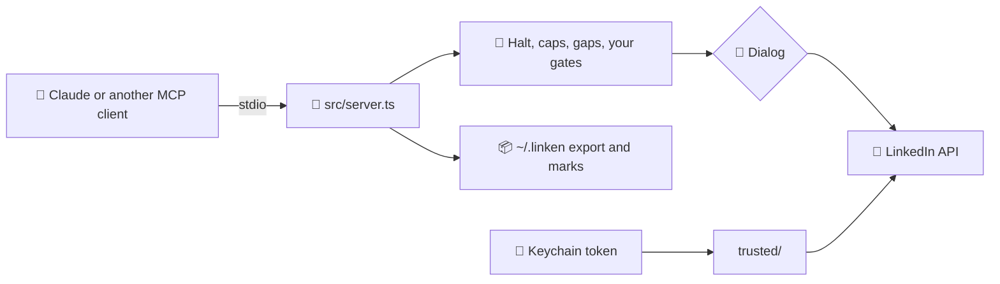

# Linken spec: build

Sections 5 and 6 of the [spec](../SPEC.md).

## 5 · How it is built

| Part | Where |
| --- | --- |
| Runtime | Node 26 runs `src/*.ts`, no build |
| Your gates | `LINKEN_GATES`: your own checks run before any write |
| Word lists | `rules/rater.default.json`, your `~/.linken/rater.json` |
| Skills | `skills/linken-post`, `skills/linken-inbox`, `skills/linken-cleanup`. The plugin ships them as plugin skills. Any other MCP client gets them from the server over the MCP Skills extension |
| Tests | `tests/`, run in CI |
| Scores | [Quality page](https://colorado-startups.github.io/linken/) |

MCP features from the 2026-07-28 spec and its extensions ([Anthropic, 2026-11-24](https://claude.com/resources/articles/skills-over-mcp-tasks-and-more)):

| Feature | Linken | Why |
| --- | --- | --- |
| Skills over MCP | ✅ Served | A client that runs Linken as a plain MCP server, such as Linken Pro's desktop config, gets the skills too |
| Tasks | Not used | Every tool answers in seconds. A post waits only on the member's own click in the dialog |
| Elicitation | Not used for approval | A client can answer a form for the member, for example through a hook. The approval stays in the trusted helper's dialog |

## 6 · Done means

| Check | Target |
| --- | --- |
| Try it with sample data | Under 2 minutes, no LinkedIn account |
| Install to first approved post | 3 steps in the [README](../README.md) |
| Posts without a click | 0 |
| Connections removed that the page showed as mattering | 0 |
| Quality page overall | 100 |
