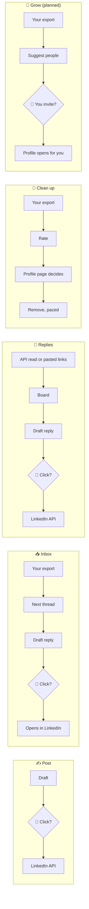

# Linken spec: jobs

Sections 1 and 2 of the [spec](../SPEC.md). Sections 3 and 4 stay there.

## 1 · Who it is for

| Person | Wants |
| --- | --- |
| 👤 A LinkedIn member | Posts and replies in their own voice, with less time spent |
| 💬 A member whose posts get comments | Every comment answered, worked like a task board |
| 🧹 A member with a messy network | Fewer spam connections, with nobody who matters removed |
| 👥 A member who wants to grow | A short list of people worth knowing, drawn from their own data |
| 🛠️ A builder | A small, readable MCP server to learn from or extend |

## 2 · The jobs

| Job | Tools | Reads | Writes |
| --- | --- | --- | --- |
| ✍️ Post | `post_publish`, `comment_create` | Your draft | A post or comment, after your click |
| 📥 Inbox | `inbox_next`, `inbox_mark`, `reply_open` | Your data export | A local mark; the reply opens for you to send |
| 💬 Replies | `replies_sync`, `replies_add`, `replies_next`, `replies_mark`, then `comment_create` | Comments on your posts and replies to your comments: the API where LinkedIn allows it, else links you paste or the one page you open | A local mark; the reply posts after your click |
| 🧹 Clean up | `connections_summary`, `connections_list`, `connections_next`, `connections_check`, `connections_check_list`, `connections_mark` | Your data export, the live profile page | A local mark; you remove in LinkedIn, paced |
| 👥 Grow (planned) | `people_suggest`, `people_mark` | Your data export only | A local mark; the profile opens and you send the invite |
| ⚙️ Setup | `archive_load`, `linken_status` | `~/.linken` | Nothing on LinkedIn |
