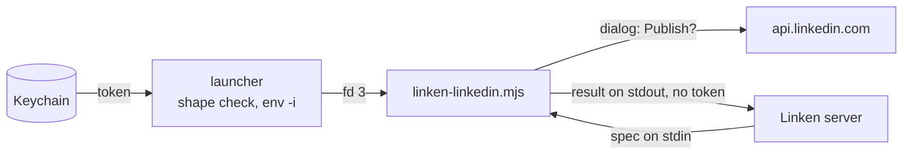

# The trusted helper

`linken-linkedin` is the one program that uses the LinkedIn token and shows the approval dialog. Threats and controls: [THREAT-MODEL.md](../THREAT-MODEL.md).

| Question | Answer |
| --- | --- |
| Why separate | Code in a checkout can be edited to leak the token or skip the dialog |
| Why trusted | Root-owned files outside any checkout. Node built-ins only, no import from `src/` |
| Token source | `LINKEDIN_ACCESS_TOKEN` from the key tool that starts it; it never enters the MCP server |
| Server side | With the token in its environment, every tool errors. Children get `HOME`, `USER`, `LOGNAME`, `PATH`, `TMPDIR` only |

## Install (`sudo ./install.sh`)

| Source | Target | Mode |
| --- | --- | --- |
| [linken-linkedin](linken-linkedin) (the launcher) | `/usr/local/bin/linken-linkedin` | root 755 |
| [linken-linkedin.mjs](linken-linkedin.mjs) | `/usr/local/lib/linken/linken-linkedin.mjs` | root 644 |
| [linken-token](linken-token) (hidden dialog → Keychain) | `/usr/local/bin/linken-token` | root 755 |

`install.sh` refuses a Node the member can write, and it tests that before it runs that Node. It takes a root-owned Node as its argument: `sudo ./install.sh /usr/local/bin/node`. The launcher refuses a token outside `A-Za-z0-9._:+/=-` (exit 4); its other checks are in [GUARANTEES.md](GUARANTEES.md).

## Contract

| Part | Shape |
| --- | --- |
| Spec (stdin) | `{ "method", "url", "headers", "json" }`, or `"file": "/absolute/path"` in place of `json` |
| Result (stdout) | `{ "status", "headers", "body" }`; headers `x-restli-id`, `location`, `content-type`, `x-li-uuid` only |
| Failure | `{ "error": "..." }` |

| Exit | Meaning |
| --- | --- |
| 0 | Sent; the HTTP status is in the result |
| 2 | Bad spec, refused host or header |
| 3 | Not approved: nothing sent |
| 4 | No token, or a misshapen one |
| 5 | Network error |

## Guarantees

Each guarantee and the test that proves it: [GUARANTEES.md](GUARANTEES.md).

## Limits

The dialog shows the first 700 characters, then the length. macOS only: without `/usr/bin/osascript` every write is refused. The untested real dialog and dialog-free uploads are accepted risks in [THREAT-MODEL.md](../THREAT-MODEL.md).
